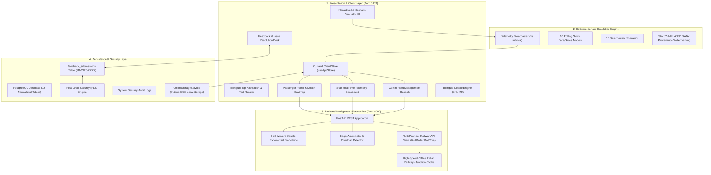
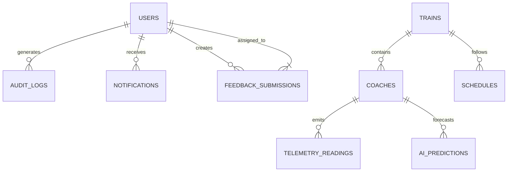

# SYSTEM ARCHITECTURE & DESIGN SPECIFICATION
## Smart Live Weight Tracker – Railway Passenger Coach Weight Monitoring & Crowd Management System

**Author:** Tirthesh Vaijnath Gutte  
**GitHub:** [https://github.com/tirthesh1104](https://github.com/tirthesh1104)  
**Target Repository:** [https://github.com/tirthesh1104/Smart-Live-Weight-Tracker](https://github.com/tirthesh1104/Smart-Live-Weight-Tracker)  
**Architecture Classification:** Decoupled Client-Server Microservices with Resilient Offline-First Fallback  

---

## 1. System Overview & Layered Architecture

The **Smart Live Weight Tracker** architecture is structured into four distinct, loosely coupled layers:
1. **Presentation & Application Layer** (React 18 + TypeScript + Tailwind CSS)
2. **Software Telemetry & Simulation Layer** (Deterministic Scenario Engine)
3. **Intelligence & Microservice Layer** (Python 3.11 + FastAPI + Holt-Winters Forecaster)
4. **Data Persistence & Security Layer** (PostgreSQL 18.6 / Supabase + Row-Level Security)



---

## 2. Presentation Layer Architecture

The frontend is constructed with modern React 18, TypeScript 5.5, Vite 5.4, and Tailwind CSS:
* **Single Page Application with Hash Router**: Utilizes `HashRouter` (`/#/...`) ensuring seamless client-side navigation without requiring server-side URL rewrite configuration.
* **Component-Driven Modular Design**:
  * `src/components/common/`: Reusable cards, navigation bar, footer, language selector, text size controller, and badge chips.
  * `src/components/dashboard/`: Coach layout visualization, crowd density bars, bogie balance meters, and live weight charts.
  * `src/components/simulator/`: Scenario palette selector, manual slider overrides, and emergency injection controls.
* **Global State Management (`zustand`)**:
  * Centralized store (`useAppStore`) manages selected train, active coach, real-time simulated telemetry, system notifications, active language, and current user session.
* **Bilingual Accessibility (WCAG 2.1 AA)**:
  * Full English and Marathi translations with standard Devanagari Unicode fonts.
  * Dynamic scaling typography with `A-`, `A`, and `A+` font size multipliers.
  * Tabular numeric styling (`font-feature-settings: 'tnum'`) ensuring jitter-free reading of live metrics.

---

## 3. Software Sensor Simulation Engine

To enable 100% software-only execution without physical hardware, the simulation engine runs entirely inside the client with optional FastAPI synchronization:

### 3.1 Certified Bogie Mass Specifications
The simulator enforces genuine Indian Railways mechanical specifications across 10 coach classes:

| Coach Type | Code | Tare Weight ($W_{\text{tare}}$) | Seating Capacity | Max Gross Load ($W_{\text{max}}$) |
| :--- | :---: | :---: | :---: | :---: |
| **LHB General Unreserved** | `GS` | 38,200 kg | 100 | 54,000 kg |
| **LHB Sleeper Class** | `SL` | 40,500 kg | 72 | 52,000 kg |
| **LHB AC 3-Tier** | `3A` | 44,800 kg | 72 | 56,000 kg |
| **LHB AC 2-Tier** | `2A` | 45,200 kg | 48 | 54,000 kg |
| **LHB AC First Class** | `1A` | 46,100 kg | 24 | 52,000 kg |
| **AC Chair Car** | `CC` | 41,000 kg | 78 | 53,500 kg |
| **Executive Chair Car** | `EC` | 42,500 kg | 56 | 52,000 kg |
| **ICF Unreserved** | `UR` | 36,000 kg | 90 | 50,000 kg |
| **ICF General Second** | `GEN` | 36,500 kg | 90 | 51,000 kg |
| **Luggage & Brake Van** | `SLRD` | 37,000 kg | 30 | 58,000 kg |

### 3.2 Telemetry Generation Pipeline
1. At each tick (default: 3 seconds), the active scenario dictates passenger occupancy percentage.
2. Estimated passenger mass is computed: $W_{\text{payload}} = P_{\text{count}} \times 75.0\text{ kg}$.
3. Load is divided across Bogie 1 and Bogie 2 with realistic Gaussian noise ($\sigma = 120\text{ kg}$).
4. Total gross weight is computed and dispatched to the global state with provenance metadata `provenance: 'SIMULATED DATA'`.

---

## 4. Backend Intelligence & Forecasting Microservice

The FastAPI service exposes RESTful endpoints with Pydantic v2 validation:
* `POST /api/v1/predict/occupancy`: Accepts historical rolling weight observations and computes 15m, 30m, and 60m predictions via Holt-Winters double exponential smoothing.
* `POST /api/v1/telemetry/process`: Ingests simulated telemetry frames, verifies structural safety limits, calculates lateral bogie balance ratios, and issues overload alerts.
* `GET /api/v1/railway/trains/{train_number}`: Multi-provider query router fetching train schedules, route intermediate stops, and coach formations.
* `GET /api/v1/railway/stations/search`: Fast station junction auto-complete with Indian railway code lookups.

---

## 5. Database Schema & Security Architecture

The database layer runs on PostgreSQL 18.6 with 19 normalized tables and strict Row Level Security (RLS):



### 5.1 Feedback & Issue Management Table (`feedback_submissions`)
```sql
CREATE TABLE public.feedback_submissions (
    id TEXT PRIMARY KEY,
    ticket_id TEXT UNIQUE NOT NULL,
    user_id UUID REFERENCES auth.users(id),
    user_name TEXT NOT NULL,
    user_email TEXT NOT NULL,
    role TEXT NOT NULL CHECK (role IN ('passenger', 'staff', 'faculty', 'admin')),
    category TEXT NOT NULL,
    priority TEXT NOT NULL CHECK (priority IN ('low', 'medium', 'high', 'critical')),
    related_module TEXT NOT NULL,
    title TEXT NOT NULL,
    description TEXT NOT NULL,
    status TEXT NOT NULL CHECK (status IN ('Submitted', 'Under Review', 'In Progress', 'Awaiting Information', 'Resolved', 'Closed', 'Rejected')),
    assigned_to TEXT,
    admin_response TEXT,
    resolved_at TIMESTAMPTZ,
    resolved_by TEXT,
    created_at TIMESTAMPTZ NOT NULL DEFAULT now(),
    updated_at TIMESTAMPTZ NOT NULL DEFAULT now()
);
```

### 5.2 Security & Access Control Model
* **Multi-Factor Authentication for Admin**: Administrator accounts enforce both password verification and a secondary 6-digit cryptographic PIN (`123456`) before granting access to sensitive controls.
* **Row-Level Security (RLS)**:
  * Passengers can only view their own submitted tickets (`auth.uid() = user_id`).
  * Railway staff can read submissions pertinent to operational coaches.
  * Administrators possess unrestricted SELECT and UPDATE privileges across all records.
* **Zero Secret Leakage**: All API keys and database credentials reside strictly in server-side `.env` files; client code uses only public anonymous access keys.

---
*System Architecture Specification formulated by Tirthesh Vaijnath Gutte.*
