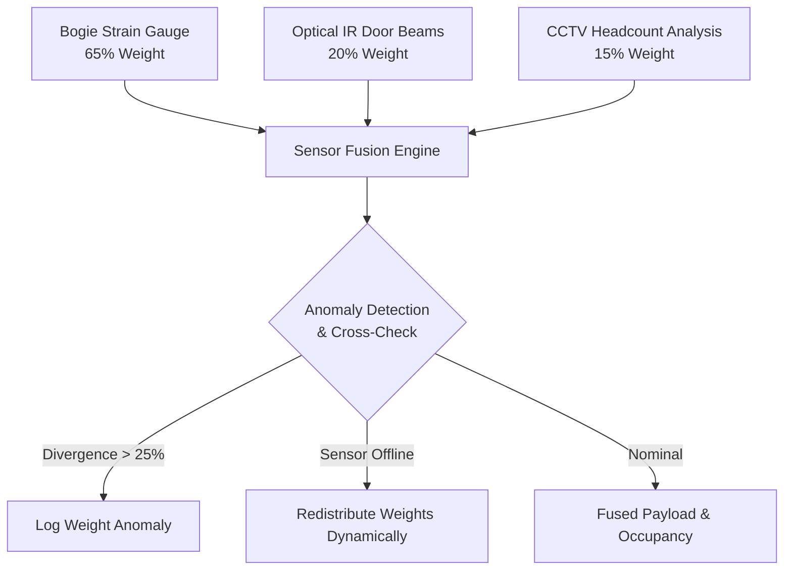

# Multi-Source Sensor Fusion Methodology & Interface Architecture
## Smart Live Weight Tracker – Robust Cyber-Physical Ingestion Engine

---

### 1. Conceptual Framework & Rationale

Single-modality sensing in high-density railway rolling stock fails under real-world conditions:
* **Strain gauges** may experience temperature drift, zero-tare shift, or electronic grounding noise.
* **Optical IR door beams** degrade due to simultaneous multi-passenger ingress, luggage occlusion, or commuter loitering in doorways.
* **CCTV computer vision** suffers from lighting changes, lens smudges, and overlapping passenger occlusions under crush load.

To resolve these vulnerabilities, the system integrates a **calibrated multi-modal sensor fusion engine** that cross-validates disparate telemetry channels, isolates anomalies, and provides a continuous, fault-tolerant estimate of coach payload and occupancy.



---

### 2. Weighted Fusion Mathematical Formulation

Let the calibrated passenger weight standard be $W_{\text{p}} = 68.0\text{ kg}$ (conforming to standard commuter survey averages).

1. **Strain Gauge Derived Occupancy:**
   $$O_{\text{strain}} = \max\left(0, \frac{W_{\text{gross}} - W_{\text{tare}}}{W_{\text{p}}}\right)$$

2. **Optical IR Passenger Count:**
   $$O_{\text{ir}} = \text{Cumulative Ingress} - \text{Cumulative Egress}$$

3. **CCTV Optical Headcount:**
   $$O_{\text{cctv}} = N_{\text{detected\_bounding\_boxes}}$$

Under standard operational conditions where all three sensor streams are active:

$$O_{\text{fused}} = \text{round}\left(0.65 \cdot O_{\text{strain}} + 0.20 \cdot O_{\text{ir}} + 0.15 \cdot O_{\text{cctv}}\right)$$

$$W_{\text{net\_fused}} = O_{\text{fused}} \cdot W_{\text{p}}$$

$$W_{\text{gross\_fused}} = W_{\text{tare}} + W_{\text{net\_fused}}$$

---

### 3. Graceful Degradation & Dynamic Weight Redistribution

When one or more sensors experience hardware failure, transmission timeout, or signal loss, the engine reallocates sensor weighting among available operational channels without service interruption:

```
+-----------------------------------------------------------------------------------------------+
| Active Sensor Configuration                       | Strain Wt | IR Wt | CCTV Wt | Fusion Mode |
|:--------------------------------------------------|:----------|:------|:--------|:------------|
| Nominal (All Sensors Healthy)                     | 0.65      | 0.20  | 0.15    | TRI_MODAL   |
| Strain Gauge Offline (IR + CCTV Active)           | 0.00      | 0.60  | 0.40    | OPTICAL_ONLY|
| Optical IR Offline (Strain + CCTV Active)         | 0.80      | 0.00  | 0.20    | STRAIN_CCTV |
| CCTV Offline (Strain + IR Active)                 | 0.75      | 0.25  | 0.00    | STRAIN_IR   |
| Strain Gauge Only                                 | 1.00      | 0.00  | 0.00    | STRAIN_SOLO |
+-----------------------------------------------------------------------------------------------+
```

---

### 4. Anomaly Detection & Cross-Validation Rules

The fusion engine continuously evaluates inter-sensor divergence:
1. **Physical Divergence Flag:** If $|O_{\text{strain}} - O_{\text{ir}}| > 0.25 \times \text{Capacity}_{\text{max}}$, a `SENSOR_DIVERGENCE_WARNING` is logged into `weight_anomaly_logs`.
2. **Door Blockage / Ingress Jam:** If $O_{\text{ir}}$ reports continuous ingress pulses with zero change in $W_{\text{gross}}$ over 30 seconds, an optical obstruction anomaly is triggered.
3. **Severe Structural Overload:** If $W_{\text{gross\_fused}} > 0.95 \times W_{\text{max\_structural}}$, an immediate `OVERLOAD_ALERT` is propagated to the Station Master and Staff consoles.

---

### 5. Physical Weight Status & Disclaimers

Every output emitted by the fusion microservice includes:
```json
"physical_weight_status": "PHYSICAL_WEIGHT_NOT_VERIFIED",
"data_origin": "SOFTWARE_DERIVED_PROTOTYPE"
```
This ensures strict compliance with railway audit standards, clearly distinguishing software prototype fusion models from legal, metrologically-certified static railway weighbridges.

---

### 6. Physical Hardware Adapter Interface Specification

For field deployment, standard abstract interfaces are specified in `backend/sensor_fusion.py`:

```python
class BaseSensorAdapter(ABC):
    @abstractmethod
    def read_telemetry(self, coach_id: str) -> Dict[str, Any]:
        """Read real-time raw values from hardware bus."""
        pass

class RS485ModbusAdapter(BaseSensorAdapter):
    """
    Interfaces with Bogie Load Cell Transducers via Modbus RTU / RS-485.
    Baud: 115200, Data Bits: 8, Parity: None, Stop: 1.
    Registers: 40001 (Gross Weight High Word), 40002 (Gross Weight Low Word).
    """

class MqttIotGatewayAdapter(BaseSensorAdapter):
    """
    Subscribes to trackside / onboard edge broker (ESP32 / STM32 nodes).
    Topic: railway/rake/{rake_id}/coach/{coach_id}/telemetry
    QoS: 1 (At least once delivery)
    """
```
