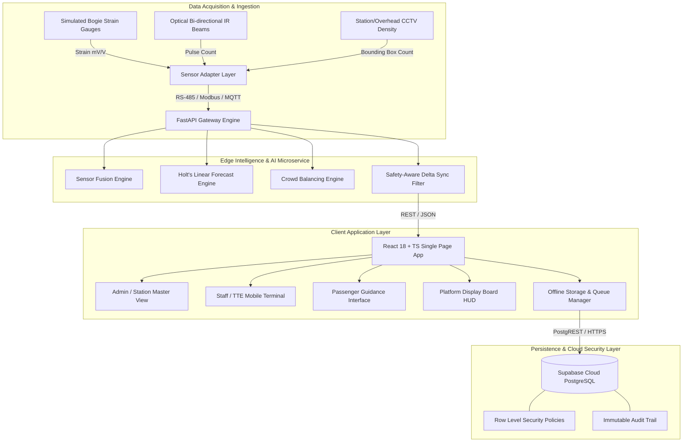

# System Architecture & Technical Specifications
## Smart Live Weight Tracker

---

### 1. Architectural Overview & Design Principles

The system adopts a modern multi-tier, reactive cyber-physical architecture designed for high availability, fault tolerance, low-latency edge filtering, and secure cloud synchronization.



---

### 2. Frontend Subsystem (`React 18 + TypeScript + Vite`)

* **Component Architecture:** Modular React Functional Components utilizing custom hooks (`useTrainData`, `useWeightCalculations`, `useOfflineQueue`).
* **State Management:** React Context API (`TrainContext`, `AuthContext`, `ThemeContext`) providing centralized reactive updates without external boilerplate.
* **Styling & UI:** Tailwind CSS with atomic utility classes supporting comprehensive **Dark Mode** and **Light Mode** themes.
* **Internationalization:** Built-in dual-language translation matrix supporting Marathi (`mr`) and English (`en`) across alerts, guidance banners, and control panels.
* **Security & Client Hygiene:** Zero leakage of service-role keys. Single active administrative session with SHA-256 salted PIN hash validation.

---

### 3. Backend AI & Edge Microservice (`FastAPI + Python 3.13`)

The backend is built with FastAPI, utilizing asynchronous handlers, Pydantic type validation, NumPy, and SciPy.

* **Key Endpoints:**
  1. `GET /health`: Microservice liveness and runtime telemetry.
  2. `GET /api/system/status`: Diagnostic readiness of AI models and adapter pipelines.
  3. `POST /predict`: Time-series passenger weight and occupancy forecasting (15, 30, 60 min).
  4. `POST /delta-sync`: Adaptive edge transmission filter evaluating payload drift against sequence order and critical safety criteria.
  5. `POST /sensor-fusion`: Tri-sensor weighted calculation with physical status tagging and anomaly detection.
  6. `POST /crowd-balance`: Dynamic rake load optimization and platform bay guidance.
  7. `POST /recommend-coach`: Passenger-specific optimal boarding coach suggestion.

---

### 4. Database & Persistence Layer (`Supabase PostgreSQL`)

The persistence tier relies on 18 normalized relational tables in Supabase PostgreSQL:
1. `users`
2. `train_rakes`
3. `coaches`
4. `weight_readings`
5. `weight_anomaly_logs`
6. `notifications`
7. `system_audit_logs`
8. `platform_displays`
9. `emergency_alerts`
10. `maintenance_records`
11. `predictions`
12. `incident_reports`
13. `sensor_calibration_logs`
14. `shift_handover_logs`
15. `passenger_assistance_requests`
16. `coach_inspections`
17. `crowd_density_snapshots`
18. `rpf_assistance_tickets`

#### Data Synchronization Protocol:
* When online: Direct asynchronous upserts via PostgREST client.
* When offline: Transaction operations are buffered into the local queue (`SyncQueueItem`) with synthetic UUIDv4 keys and ISO-8601 UTC timestamps.
* Upon reconnection: Idempotent queue reconciliation executes with primary key conflict arbitration (`localTime > cloudTime`), eliminating duplicate inserts.

---

### 5. Hardware Interfacing & Deployment Specification

To facilitate physical deployment on rolling stock and trackside infrastructure, the system defines standardized protocol adapters:

```
+-----------------------------------------------------------------------------------------+
| Interface Protocol | Physical Standard | Target Hardware Module                         |
|:-------------------|:------------------|:-----------------------------------------------|
| RS-485 / Modbus RTU| Differential 2-wire| Bogie Axle-Box Strain Transducers (LVDT/Strain)|
| Optical Pulse      | GPIO / Optocoupler| IR Door Frame Photodiode Arrays               |
| RTSP / ONVIF       | 100BASE-TX IP     | Station Platform / Overhead Coach IP Cameras   |
| MQTT / LoRaWAN     | Sub-GHz / Cellular | Trackside Edge Ingestion Gateway (ESP32/STM32) |
+-----------------------------------------------------------------------------------------+
```
