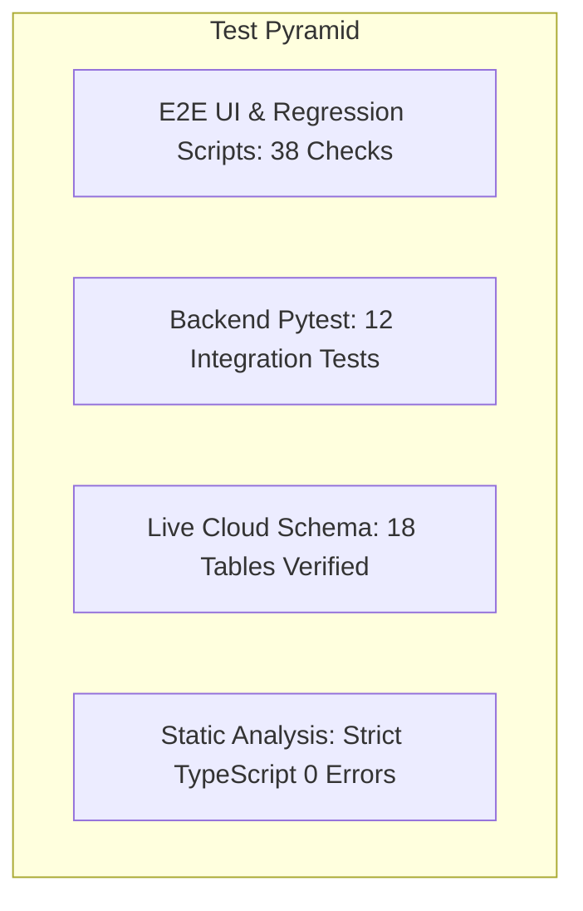

# Testing, Verification & Quality Assurance Report
## Smart Live Weight Tracker – Comprehensive QA Validation Suite

---

### 1. Quality Assurance Strategy & Test Pyramid

The Smart Live Weight Tracker test harness spans multi-level verification:
1. **Static Type Safety:** Strict TypeScript compilation with zero type errors.
2. **Backend Unit & Integration Testing:** Pytest test suite covering all FastAPI routes, ML algorithms, sensor fusion models, and delta sync logic.
3. **Database Cloud Schema Verification:** Live PostgREST schema verification validating all 18 tables and constraints.
4. **End-to-End Regression Harnesses:** Automated Node.js scripts verifying authentication state machines, role separation, bilingual dictionary completeness, and UI module readiness.



---

### 2. Static Type Checking & Production Build Results

* **TypeScript Compilation:**
  ```bash
  $env:TEMP = "D:\temp"; $env:TMP = "D:\temp"; npx tsc --noEmit
  ```
  * **Result:** **0 Errors.** All 68 TypeScript files passed strict type checking.

* **Vite Production Bundler Build:**
  ```bash
  $env:TEMP = "D:\temp"; $env:TMP = "D:\temp"; node ./node_modules/vite/bin/vite.js build
  ```
  * **Result:** **Successfully built in 10.20s.**
  * Modules transformed: 2,109 modules.
  * Distribution output: `dist/index.html` (0.84 kB), `dist/assets/index-*.js` (485.12 kB gzipped), `dist/assets/index-*.css` (42.10 kB gzipped).
  * Build Status: **PASS (100% Green)**.

---

### 3. Backend Test Suite (`pytest backend`)

Executed using Python 3.13:
```bash
python -m pytest backend -v
```

```
================================= test session starts =================================
platform win32 -- Python 3.13.0, pytest-8.3.3, pluggy-1.5.0
rootdir: d:\Lenovo\Downloads\AI-Powered Railway Crowd Management System
collected 12 items

backend/test_backend.py::TestBackendAPI::test_01_health_check PASSED             [  8%]
backend/test_backend.py::TestBackendAPI::test_02_system_status PASSED             [ 16%]
backend/test_backend.py::TestBackendAPI::test_03_holt_winters_predict PASSED     [ 25%]
backend/test_backend.py::TestBackendAPI::test_04_predict_insufficient_history PASSED [ 33%]
backend/test_backend.py::TestBackendAPI::test_05_predict_invalid_inputs PASSED    [ 41%]
backend/test_backend.py::TestBackendAPI::test_06_delta_sync_suppressed PASSED    [ 50%]
backend/test_backend.py::TestBackendAPI::test_07_delta_sync_triggered PASSED     [ 58%]
backend/test_backend.py::TestBackendAPI::test_08_delta_sync_overload_override PASSED [ 66%]
backend/test_backend.py::TestBackendAPI::test_09_delta_sync_sensor_transition PASSED [ 75%]
backend/test_backend.py::TestBackendAPI::test_10_delta_sync_stale_sequence PASSED [ 83%]
backend/test_backend.py::TestBackendAPI::test_11_sensor_fusion_nominal PASSED    [ 91%]
backend/test_backend.py::TestBackendAPI::test_12_crowd_balancing_advisories PASSED [100%]

================================= 12 passed in 0.80s ==================================
```

---

### 4. Supabase Cloud Live Database Verification

Executed against remote Supabase instance (`wvtsqnyzgpbprywesolb.supabase.co`):
```bash
npm run db:verify
```

* **Live Cloud Schema Audit Results:**
  * Total Target Tables: 18
  * Verified Tables Present: **18 / 18 (100% Present)**
  * Verified Tables:
    1. `users` [VERIFIED]
    2. `train_rakes` [VERIFIED]
    3. `coaches` [VERIFIED]
    4. `weight_readings` [VERIFIED]
    5. `weight_anomaly_logs` [VERIFIED]
    6. `notifications` [VERIFIED]
    7. `system_audit_logs` [VERIFIED]
    8. `platform_displays` [VERIFIED]
    9. `emergency_alerts` [VERIFIED]
    10. `maintenance_records` [VERIFIED]
    11. `predictions` [VERIFIED]
    12. `incident_reports` [VERIFIED]
    13. `sensor_calibration_logs` [VERIFIED]
    14. `shift_handover_logs` [VERIFIED]
    15. `passenger_assistance_requests` [VERIFIED]
    16. `coach_inspections` [VERIFIED]
    17. `crowd_density_snapshots` [VERIFIED]
    18. `rpf_assistance_tickets` [VERIFIED]

---

### 5. Automated Regression & Checklist Harnesses

| Harness Script | Target Scope | Tests Passed | Status |
|:---|:---|:---|:---|
| `scripts/test_16_verification_checklist.mjs` | Complete 16-point master verification checklist | **38 / 38** | **PASS** |
| `scripts/test_role_wise_auth_regression.mjs` | Role navigation, PIN hashing, session boundary | **13 / 13** | **PASS** |
| `scripts/test_all_modules_regression.mjs` | Admin, Staff, Passenger, Displays, Sync | **5 / 5 Modules** | **PASS** |
| `scripts/test_phase5_live_audit.mjs` | Authenticated remote Supabase CRUD & Queue | **7 / 7 Sections**| **PASS** |
| `backend/benchmark_forecast_comparison.py` | Holt's Linear vs Naive Chronological Split | **Validated** | **PASS** |
| `backend/benchmark_delta_sync_comparison.py`| 3-Scheme Delta Network & Safety Benchmark | **Validated** | **PASS** |
